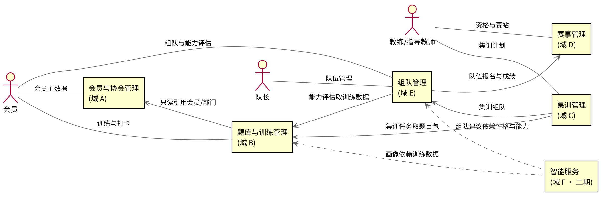
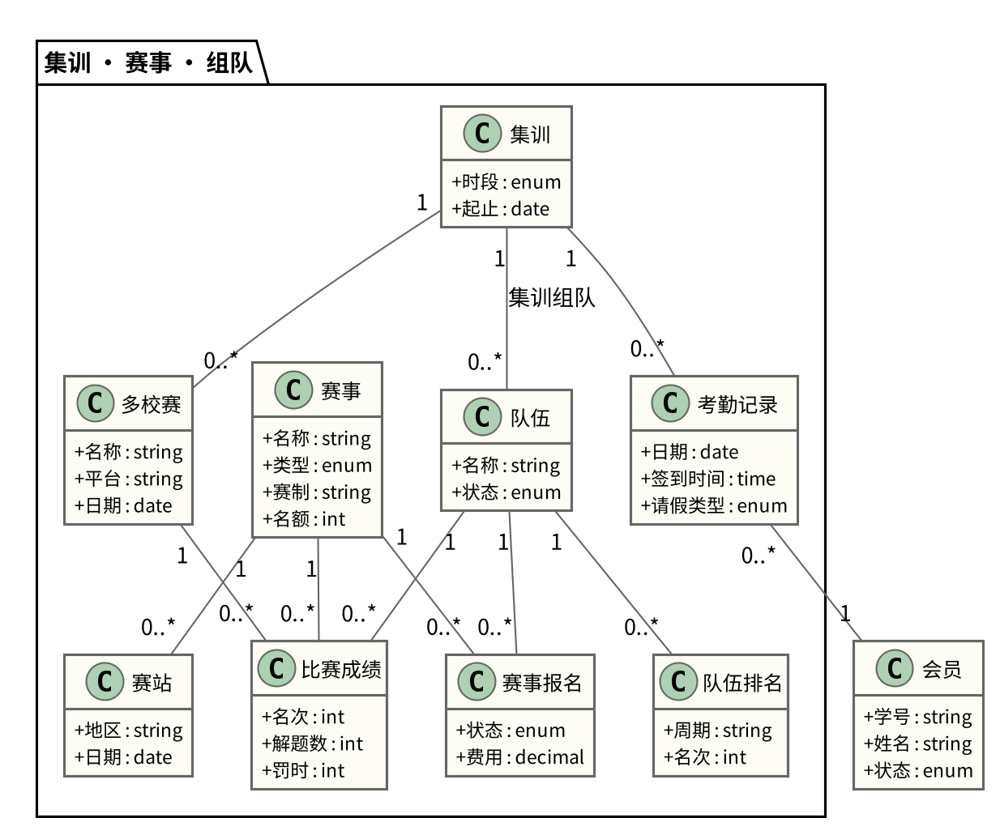

<div align="center">

# 拾阶 · ladder-up

**高校算法竞赛集训队的事务管理平台**

> 会员、题库、集训、赛事、组队 —— 五条主线，一级一级往上走。

[](LICENSE)
[](pyproject.toml)
[](app/main.py)
[](#当前进度)
[](docs/)
[](diagrams/)

[快速开始](#快速开始) •
[五条主线](#五条主线) •
[数据模型](#数据模型) •
[当前进度](#当前进度) •
[文档](#文档)

</div>

---

## 它解决什么问题

一个集训队（会员几十到几百人、每年几场校赛与区域赛）的日常事务，难的不是“缺功能”，而是**同一份数据在 Excel、群聊、OJ 账号、个人笔记里各有一份，且对不上**：

| 现象 | 后果 |
|---|---|
| 会员一年一换，换届后系统里还是上一任负责人 | 新负责人接手先花一周对账 |
| 训练计划在群里口头安排，打卡与考勤各记一套 | 谁练了、谁没练，说不清 |
| 赛前人工统计谁能参赛、赛站怎么分 | 临赛前还在拉表 |
| 赛后队伍战绩没有沉淀 | 第二年重新来过 |

拾阶把这五条链路收成一个系统，并给出统一的选拔依据：


## 五条主线



| 域 | 名称 | 功能数 | 期次 |
|---|---|---|---|
| A | 会员与协会管理 | 8 | 一期 |
| B | 题库与训练管理 | 15 | 一期 |
| C | 集训管理 | 9 | 二期 |
| D | 赛事管理 | 15 | 二期 |
| E | 组队管理 | 7 | 二期 |
| F | 智能服务（性格测评、个性化推荐） | 5 | 三期 |

寒假与暑假集训在原始需求里是两套子系统，本设计合并为同一流程的两个时段；6 组重复功能已合并，对照表见需求基线第 5 节。

## 数据模型

20 个实体、38 张表（一期 27 / 二期 11），以集训、赛事、组队三域为例：



完整 DDL 与索引、约束理由见 [`docs/数据库设计-v1.0.md`](docs/数据库设计-v1.0.md)。

## 当前进度

版本 **0.11.0**（2026-11-25）。一期七个切片已全部完成，23 项功能全部有可运行实现：

- [x] S1 骨架与认证
- [x] S2 入会
- [x] S3 题库
- [x] S4 训练
- [x] S5 考核与转正
- [x] S6 档案与统计
- [x] S7 OJ 同步与训练建议

设计定稿前经过五轮开工前评审，评分 69 → 76 → 80 → 85 → 89；`docs/review/` 只保留末轮放行结论，前四轮在 git 历史里。各切片的代码评审结论同样在 [`docs/review/`](docs/review/)。

## 快速开始

```bash
make install     # 安装依赖
make migrate     # 建库并跑迁移
make seed        # 灌入种子数据（部门、角色、管理员、样例会员）
make run         # 启动服务，打开 http://localhost:8000
```

```bash
make test        # pytest，全绿
make smoke       # 迁移 → 种子 → 健康检查 → 登录 → 越权 → 撤销
make diagrams    # 由 diagrams/src/*.puml 出 PNG 到 diagrams/
make docs        # 文档转 docx / pdf 到 docs/_build
```

也可以用 Docker Compose 两容器部署（proxy + app），见 `docker-compose.yml`。

依赖：`plantuml`（出图）、`pandoc` 或带 `pypandoc` 的 Python（转文档）、`soffice`（docx → pdf）。

## 技术栈

Python 3.11 + FastAPI + SQLAlchemy 2.0 + SQLite（WAL）+ Jinja2 + Bootstrap 5.3.3 + Bootstrap Icons（本地托管），单机 Docker Compose 两容器部署。

认证用服务端会话而非 JWT，定时任务用 systemd timer 触发一次性 CLI，备份走 SQLite Online Backup API。选型理由见 [ADR 0002](docs/adr/0002-技术选型与待确认项.md) 与 [ADR 0003](docs/adr/0003-会话认证与运行契约.md)；数据库 DDL 以 MySQL 语法表达逻辑模型，落地按 `docs/数据库设计-v1.0.md` 第 4.0 节映射。

## 设计要点

- **幂等靠业务键**：OJ 提交以 `(platform, externalId)`、打卡以 `(member, task, date)`、成绩以 `(test, member)` 去重，重复提交返回 40901 并带已有记录 id；不引入通用幂等请求头。
- **批量事务**：参赛资格确定与赛站分配在一个事务内提交，名额冲突整体回滚并返回冲突明细。
- **状态在应用层校验**：不用数据库触发器做状态迁移，便于给出可读错误也能单测。
- **学年归档锁定**：归档后学年数据只读，报表默认只查当前学年，避免主表膨胀。

## 文档

<details>
<summary><b>文档（20 份 / 158 页，点击展开）</b></summary>

| 文件 | 页 | 内容 |
|---|---|---|
| [`docs/需求基线-v1.2.md`](docs/需求基线-v1.2.md) | 16 | 6 个域、9 个参与者、54 个功能、20 个实体、4 个状态机、5 条关键流程；第 10 节 10 项决策全部定稿 |
| [`docs/设计说明书-v1.0.md`](docs/设计说明书-v1.0.md) | 15 | 分层架构、模块划分、技术选型对比、8 条关键设计决策、权限矩阵、非功能设计、部署与演进 |
| [`docs/数据库设计-v1.0.md`](docs/数据库设计-v1.0.md) | 22 | 38 张表清单（一期 27 / 二期 11）+ 27 张完整 DDL、SQLite 方言映射、索引与约束理由、枚举字典、功能到表的映射 |
| [`docs/接口设计-v1.0.md`](docs/接口设计-v1.0.md) | 15 | 通用约定、错误码表、约 90 个 REST 接口、4 个关键接口示例、外部集成约束 |
| [`docs/测试计划-v1.0.md`](docs/测试计划-v1.0.md) | 22 | 四层测试策略、54 条功能的覆盖矩阵、12 条详细场景用例、缺陷管理 |
| [`docs/项目计划-v1.0.md`](docs/项目计划-v1.0.md) | 14 | 真实日期的 4 周里程碑、7 个纵向切片、按 AI 协作模式的工时口径、质量门槛 |
| [`docs/开发路线-v1.0.md`](docs/开发路线-v1.0.md) | 6 | 切片级执行清单：交付文件、验收命令、协作方式、各切片实际结果、交付周动作 |
| [`docs/验收矩阵-v1.0.md`](docs/验收矩阵-v1.0.md) | 10 | 23 项功能逐项判定（12 通过 / 11 部分实现 / 0 未实现），用例数取自实测；含非功能项与「尚未验证」清单 |
| [`docs/演练记录-备份恢复-v1.0.md`](docs/演练记录-备份恢复-v1.0.md) | 5 | 真实执行的备份→破坏→恢复→校验：146 行 / 27 表 / 2 附件，备份 0.84 s、恢复 8 ms、行数与附件指纹全一致 |
| [`docs/review/gpt-review-v1.4.md`](docs/review/gpt-review-v1.4.md) | 3 | 开工前五轮技术评审的末轮放行结论（前四轮见 git 历史） |
| [`docs/review/s2-code-review.md`](docs/review/s2-code-review.md) | 4 | S2 代码评审：必须修 10 条 |
| [`docs/review/s3-code-review.md`](docs/review/s3-code-review.md) | 3 | S3 代码评审：必须修 10 条 |
| [`docs/review/s4-code-review.md`](docs/review/s4-code-review.md) | 3 | S4 代码评审：必须修 9 条 |
| [`docs/review/s5-code-review.md`](docs/review/s5-code-review.md) | 3 | S5 代码评审：必须修 7 条 |
| [`docs/review/s6-code-review.md`](docs/review/s6-code-review.md) | 4 | S6 代码评审：必须修 8 条 |
| [`docs/review/s7-code-review.md`](docs/review/s7-code-review.md) | 3 | S7 代码评审：必须修 8 条 |
| [`docs/review/ui-bootstrap5-review.md`](docs/review/ui-bootstrap5-review.md) | 3 | 前端统一改造评审 |
| [`docs/图目录.md`](docs/图目录.md) | 3 | 18 张图的编号与用途 |
| [`docs/工程规范.md`](docs/工程规范.md) | 3 | 目录、命名、提交信息、分支、文档与图的管理约定、工具与门禁 |
| [`docs/来源说明.md`](docs/来源说明.md) | 1 | 需求来源、与原始材料的关系、名称与商标说明 |
| [`docs/adr/`](docs/adr/) | — | 0001 需求基线先于 UML 设计、0002 技术选型与待确认项、0003 会话认证与运行契约、0004 前端样式与组件库 |

页数为 `make docs` 生成的 PDF 实测值，源文件是 Markdown。ADR 为多文件目录，不单独出 PDF。
</details>

<details>
<summary><b>UML 图（18 张，点击展开）</b></summary>

| 类别 | 数量 | 内容 |
|---|---|---|
| 用例图 | 6 | 五个业务域各一张 + 一张域间依赖图 |
| 类图 | 3 | 覆盖 20 个实体，标注基数 |
| 状态机 | 4 | 会员、队伍、赛事、集训 |
| 时序图 | 5 | 入会、训练闭环、集训、参赛、年度归档 |

图源在 `diagrams/src/*.puml`，PNG 与源文件成对提交。

</details>

## 结构

```
app/             FastAPI 应用（路由、认证、业务模块、模板、静态资源）
alembic/         数据库迁移
assets/          README 配图（海报横幅）
bin/             seed、定时作业、备份与恢复校验
deploy/          systemd unit / timer、容器相关文件
diagrams/        PlantUML 图源（src/）与 PNG
docs/            需求基线、设计、数据库、接口、测试、计划、验收矩阵、演练记录
docs/adr/        架构决策记录
docs/review/     各切片代码评审结论
scripts/         出图、文档转换、烟测与切片探针
tests/           测试
```

## 贡献

见 [CONTRIBUTING.md](CONTRIBUTING.md)。当前阶段最有价值的贡献是指出文档之间的口径矛盾。

## 许可

[MIT](LICENSE)。文档中的示例数据均为虚构，不含真实成员信息。
